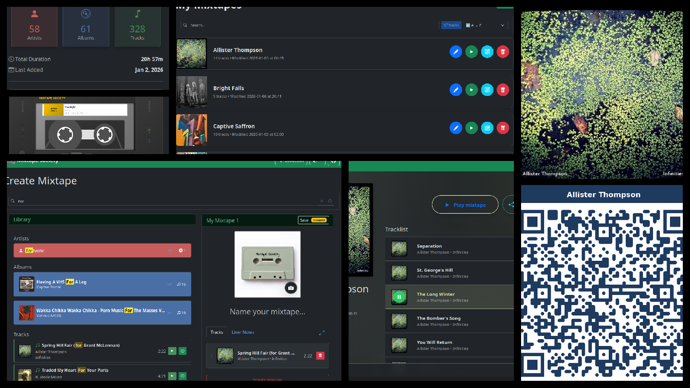

# Mixtape Society 📼🎧🧑‍🤝‍🧑

**A private, self-hosted web app to create, edit, share and play music mixtapes from your personal library.**

No accounts, no telemetry, no Spotify – just your music, your server, your rules.



## ✨ Features

### 📼✍️🎶 For Mixtape Creators

- **Private music library** – Host your own collection (FLAC, MP3, M4A, AAC, OGG, WAV)
- **Custom cover art** – Upload unique artwork for each mixtape
- **Liner notes** – Add personal messages with Markdown formatting
- **Smart caching** – Pre-transcode for faster mobile streaming for multiple audio quality options (original to 128k)
- **Instant public links** – Share via URL, QR code or print-ready codes with cover art
- **Permanent or temporary** – Links persist until you delete them
- **Gift rituals** – Add a gifting ritual for mixtape receivers.

### 📼🤲🎧 For Mixtape Receivers

- **No accounts needed** – Just click and play
- **Lock screen integration** – Control from phone notifications
- **Background playback** – Keep playing with screen off
- **Personalized PWA** – Each mixtape installs like an app with its own icon and name
- **Stream anywhere** – Stream to Chromecast devices in your car or throughout your house

Perfect for:

- 🎉 **Parties** – Share the DJ duties via QR code
- 🏠 **Home audio** – Stream to whole-home speaker systems
- 🚗 **Road trips** – Perfect mixtapes for long drives
- 🎁 **Gifts** – Create physical cards with QR codes that stream anywhere
- 🌙 **Ambient listening** – Set the mood without managing your phone

## 🚀 Quick Start

```sh
docker run -d \
  --name mixtape-society \
  --restart unless-stopped \
  -p 5001:5000 \
  -v /path/to/your/music:/music:ro \
  -v /data/mixtape-society:/app/collection-data \
  -e PASSWORD=YourStrongPassword123! \
  ghcr.io/mark-me/mixtape-society:latest
```

Open [http://localhost:5001](http://localhost:5001) – Done!

## 📖 Project docs

- 🏠 [Full Documentation](https://mark-me.github.io/mixtape-society/index.html)
- 🚀 [Getting Started](https://mark-me.github.io/mixtape-society/user/getting-started.html)
- 🛠️ [Development documentation](https://mark-me.github.io/mixtape-society/development/intro.html)
- 🙌 [Acknowledgements](https://mark-me.github.io/mixtape-society/project/about.html#acknowledgements)

## 👥 Get Involved

Interested in where this is headed?

- 💡 [Browse ideas being explored](https://mark-me.github.io/mixtape-society/project/ideas/ideas.html)
- 🎯 [See what's planned next](https://mark-me.github.io/mixtape-society/project/roadmap.html)
- 📝 [Read what's been shipped](https://mark-me.github.io/mixtape-society/project/changelog.html)
- 💬 Share thoughts on [GitHub Discussions](https://github.com/mark-me/mixtape-society/discussions)
- 🐛 Report issues or open an [issue](https://github.com/mark-me/mixtape-society/issues)

Pull requests welcome. Still early days, but contributions appreciated.

## ⚖️ Legal & Copyright Notice

This software is a tool for personal, non-commercial use with legally owned music files.

No copyrighted music or artwork is included
You are solely responsible for the media you host and share
Public links should only be shared with people you trust or protected with a password

See [DISCLAIMER](./DISCLAIMER) for full text.

Made with love for real mixtapes in a digital world.


