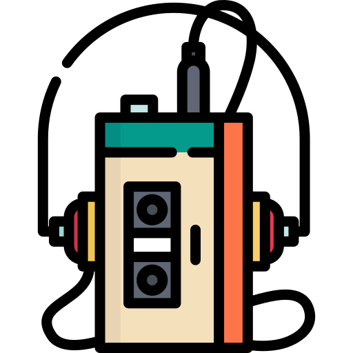

{ align=right width="90" }

# Player Guide for Recipients

Master the mixtape player to get the best listening experience. Whether you're on your phone, computer, or casting to a TV, this guide covers everything you need to know.

---

## 🎮 Basic Controls

### Play & Pause

**Desktop:**

- Click the **▶️ Play** button
- Click again (now **⏸️ Pause**) to pause
- Press **Space bar** for quick play/pause

**Mobile:**

- Tap the play button
- Tap again to pause
- Use lock screen controls

### Skip Tracks

**Next Track:**

- Desktop: Click **⏭️** or press **→ Right Arrow**
- Mobile: Tap **⏭️** or use lock screen controls

**Previous Track:**

- Desktop: Click **⏮️** or press **← Left Arrow**
- Mobile: Tap **⏮️** or use lock screen controls

### Seek Within a Track

**Desktop:**

- Click anywhere on the progress bar
- Drag the position handle
- Use arrow keys for fine control

**Mobile:**

- Tap on the progress bar
- Drag the progress handle

---

## 🎵 Advanced Features

### Shuffle Mode

Play tracks in random order instead of the mixtape's sequence.

**How to enable:**

1. Find the **🔀 Shuffle** button next to the prev/next controls
2. Click/tap to toggle on (button lights up)
3. Click/tap again to return to normal order

**What happens:**

- Tracks play in a random sequence
- Next/Previous buttons follow the shuffled order
- Your shuffle order stays the same even if you reload the page

**Visual indicator:**

- **Off:** Button is outlined (⚪ 🔀)
- **On:** Button is filled (⚫ 🔀)

**When it's useful:**

- You've listened through already and want variety
- Long mixtapes (20+ tracks)
- Background music where order doesn't matter
- Discovering tracks you might have skipped

**Getting a new shuffle:**
Click shuffle off, then on again to get a different random order.

!!! note
    The creator carefully ordered the tracks—shuffle changes the intended experience! Best for repeat listens.

### Repeat Mode

Loop the entire mixtape or a single track.

**How to use:**

1. Find the **🔁 Repeat** button next to shuffle
2. Click/tap to cycle through modes
3. Watch the button change to show which mode is active

**The three modes:**

#### 🔁 Repeat Off (default)

- Button is outlined
- Mixtape plays through once and stops
- Normal listening experience

#### 🔁 Repeat All

- Button is filled/solid white
- Mixtape loops back to the beginning after the last track
- Great for background music or extended listening

#### 🔁₁ Repeat One

- Button turns blue with a "1" icon
- Current track plays over and over
- Perfect for learning lyrics or focusing on one song

**What happens:**

- Your repeat setting saves automatically
- Works with shuffle (loops through the shuffled order)
- Click any track to play it, repeat mode stays active

**When it's useful:**

- **Repeat All:** Long car rides, work sessions, parties
- **Repeat One:** Practicing a song, meditation, focus

**Getting back to normal:**
Click the repeat button until it's outlined again (Repeat Off).

!!! tip "Repeat + Shuffle"
    Enable both for endless variety! The playlist will keep looping through the same shuffle order.

### Sleep Timer

Automatically stop playback after a set duration—perfect for falling asleep or timed listening sessions.

**How to use:**

1. Find the **⏰ Sleep Timer** button next to shuffle and repeat
2. Click/tap to open the timer settings
3. Choose a duration or use quick presets
4. Optional: Enable "Wait until current track ends"
5. Click **Start Timer**

**Setting the duration:**

- **Quick presets:** 15, 30, 45, or 60 minutes
- **Custom time:** Use the slider for any duration (5-120 minutes)
- **Visual display:** Large timer shows your selected duration

**Wait until track ends:**
When enabled, playback stops gracefully after the current track finishes instead of cutting off mid-song.

**Visual indicator:**

- **Off:** Button is outlined (⚪ ⏰)
- **Active:** Button turns yellow and pulses (🟡 ⏰)

**What happens:**

- Timer counts down in the background
- You'll see notifications at 30min, 15min, 10min, 5min, and 1min remaining
- Each notification includes options to extend or cancel
- When time expires, playback stops automatically
- Your preferred duration is remembered for next time

**Managing active timer:**

- **Modify:** Click the pulsing timer button to adjust time
- **Cancel:** Use the cancel button in settings or notifications
- **Extend:** Click "Extend" in countdown notifications

**When it's useful:**

- Falling asleep to music
- Timed meditation or focus sessions
- Conserving battery on mobile
- Limiting listening time
- Background music for specific activities

!!! tip "Perfect for Sleep"
    Set 30-45 minutes with "wait until track ends" enabled. The music fades naturally as your last track finishes, instead of jarring silence mid-song.

### Volume Control

Adjust playback volume independent of your device volume.

**Desktop:**

- Click **🔊 Volume** icon
- Drag slider up/down
- Or use your keyboard volume keys

**Mobile:**

- Use device volume buttons
- Player respects system volume

---

## 📊 Audio Quality Settings

Adjust streaming quality to match your connection and data plan.

### Quality Options

| Quality | Bitrate | File Size/Song | Best For |
| ------- | ------- | -------------- | -------- |
| **Original** | Variable | ~10MB | WiFi, best audio |
| **High** | 256 kbps | ~7MB | WiFi, great audio |
| **Medium** | 192 kbps | ~5MB | Default, balanced |
| **Low** | 128 kbps | ~3MB | Mobile data, slow connections |

**Default:** Medium (192 kbps)

### How to Change Quality

1. Look for the **⚙️ Settings** or **Quality** button
2. Select your preferred quality
3. Current track will restart at new quality
4. Setting persists for this mixtape session

### When to Adjust

**Use Higher Quality (Original/High) when:**

- ✅ Connected to WiFi
- ✅ Using unlimited data plan
- ✅ Want best possible sound
- ✅ Using good headphones or speakers
- ✅ Connection is fast and stable

**Use Lower Quality (Low) when:**

- ✅ On limited mobile data plan
- ✅ Connection is slow or unstable
- ✅ Playback keeps buffering
- ✅ In area with weak signal
- ✅ Want to conserve data

!!! tip "Connection Issues?"
    If playback stutters or stops frequently, try switching to a lower quality setting. The difference is often imperceptible with standard headphones.

### 📼 The Sound of a Cassette

In cassette mode, the mixtape also sounds like a cassette: a TDK D90, with soft tape hiss, a slight wobble, and a little less treble. Switch back to the modern view for the normal sound; the track carries on where it was. On a Chromecast, you always hear the normal sound.

---

## ⌨️ Keyboard Shortcuts (Desktop)

Master these shortcuts for effortless control:

| Key | Action |
| --- | ------ |
| **Space** | Play/Pause |
| **→** | Next track |
| **←** | Previous track |
| **↑** | Volume up |
| **↓** | Volume down |
| **M** | Mute/Unmute |
| **S** | Toggle shuffle |
| **R** | Cycle repeat modes |
| **T** | Open sleep timer |
| **0-9** | Jump to position (0%=start, 5=50%, 9=90%) |

!!! tip "Power User"
    Once you learn the shortcuts, you can control playback without touching your mouse!

---

## 📱 Mobile & Desktop Experience

### iPhone & iPad

**Best Browser:** Safari (required for AirPlay)

**Features:**

- ✅ Lock screen controls
- ✅ Control Center access
- ✅ Background playback
- ✅ AirPlay support
- ✅ Apple Watch controls (if paired)
- ✅ CarPlay support (iOS 14.5+)
- ✅ Sleep timer with notifications

**Lock Screen Controls:**
When playing, you'll see:

- Album art
- Track title and artist
- Play/Pause button
- Next/Previous buttons
- Progress bar
- AirPlay icon

**Control Center:**
Swipe down from top-right (iPhone X+) or swipe up (older iPhones) to access quick controls.

**Add to Home Screen:**

1. Tap **Share** button in Safari
2. Select **"Add to Home Screen"**
3. Name it (e.g., "Sarah's Mixtape")
4. Tap **Add**
5. Access from home screen like an app

!!! tip "Best Experience"
    Adding to home screen gives you a dedicated icon and faster access. The player works perfectly as a "web app"!

### Android

**Best Browser:** Chrome

**Features:**

- ✅ Lock screen controls
- ✅ Notification controls
- ✅ Background playback
- ✅ Chromecast support
- ✅ Android Auto support
- ✅ Media key support
- ✅ Sleep timer with notifications

**Lock Screen:**
Full media controls appear automatically when playing.

**Notification Shade:**
Pull down to access playback controls without opening the browser.

**Add to Home Screen:**

1. Tap **⋮ Menu** in Chrome
2. Select **"Add to Home screen"**
3. Name it and confirm
4. Access from app drawer

**Android Auto:**
If connected to car:

1. Mixtape appears in Android Auto
2. Use dashboard or voice controls
3. Safe, hands-free operation

### Desktop (Windows, Mac, Linux)

**Works in any modern browser:**

- Chrome
- Firefox
- Safari
- Edge
- Opera

**Features:**

- ✅ Large album art display
- ✅ Full track listing always visible
- ✅ Keyboard shortcuts
- ✅ Media key support
- ✅ Better for long sessions

**Media Keys:**
Hardware media keys on your keyboard work automatically:

- Play/Pause key
- Next/Previous track keys
- Volume keys

**Window Control:**
Minimize the browser and controls work from background:

- Lock screen (Windows/Mac)
- Notification area
- Media popup

---

## 🎨 Visual Features

### Album Art Display

**Desktop:**

- Large, prominent display
- Click to expand (if supported)
- Shows during playback

**Mobile:**

- Optimized for screen size
- Visible on lock screen
- Shows in notifications

### Track Listing

**Desktop:**

- Full tracklist always visible
- Current track highlighted
- Click any track to jump to it
- Shows track numbers, titles, artists

**Mobile:**

- Swipe or scroll to see full list
- Current track highlighted
- Tap any track to jump to it
- Compact view for small screens

### Liner Notes

If the creator added liner notes (personal message):

- **Gift links:** Displayed on landing page
- **Direct links:** Usually in expandable section
- **May include:** Track references (#1, #1-4 converted to titles)

---

## 🔄 Playback States

### Playing ▶️

**Visual indicators:**

- Play button shows pause icon
- Progress bar advances
- Track time updates
- Waveform animation (if present)

**While playing:**

- Screen can turn off (mobile)
- Can switch apps (background playback)
- Lock screen controls available

### Paused ⏸️

**Visual indicators:**

- Pause button shows play icon
- Progress bar stopped
- Animation frozen

**While paused:**

- Position saved
- Resume from same point
- Battery-friendly

### Buffering ⏳

**What's happening:**

- Loading next segment
- Usually brief
- Normal on first load

**If buffering frequently:**

- Switch to lower quality
- Check internet connection
- Move closer to WiFi router

### Loading/Seeking ⌛

**What's happening:**

- Loading new track
- Jumping to different position
- Switching quality

**Usually quick** - should resolve in 1-2 seconds

---

## 🎧 Best Listening Practices

### For First Listen

1. **Find quiet time** - Appreciate the creator's work
2. **Read liner notes** - Understand their message
3. **Listen in order** - Experience the intended flow
4. **No distractions** - Give it your full attention

### For Repeated Listening

- Try shuffle mode for variety
- Different contexts (workout, relaxation, driving)
- Cast to different speakers/rooms
- Share with others

### Battery Life (Mobile)

**To maximize battery:**

- ✅ Use lower quality settings
- ✅ Download for offline (if available in future)
- ✅ Close other apps
- ✅ Reduce screen brightness
- ✅ Use battery saver mode

---

## 🔊 Sound Quality Tips

### Get the Best Audio

**Headphones/Earbuds:**

- Use good quality headphones
- Wired often better than Bluetooth
- Ensure proper fit and seal

**Speakers:**

- Cast to quality speakers when possible
- Position speakers properly
- Adjust room acoustics

**Settings:**

- Use highest quality your connection allows
- Disable other bandwidth-heavy apps
- Close unnecessary browser tabs

---

## 📱 Offline Listening

**Currently:** Mixtapes require internet connection

**Future possibilities:**

- Offline mode for saved mixtapes
- Background sync when on WiFi
- Full offline playback

Check with the creator about their server's features.

---

## ❓ Common Issues

### Playback Won't Start

**Solutions:**

1. Refresh the page
2. Check internet connection
3. Try different browser
4. Clear browser cache
5. Disable browser extensions

### Stuttering or Buffering

**Solutions:**

1. Switch to lower quality
2. Pause and let it buffer
3. Close other apps/tabs
4. Move closer to router
5. Restart your router

### Controls Not Working

**Solutions:**

1. Refresh the page
2. Check if browser is up to date
3. Try different browser
4. Disable ad blockers
5. Check if JavaScript is enabled

### Audio Cutting Out

**Solutions:**

1. Check Bluetooth connection
2. Restart Bluetooth
3. Use wired headphones
4. Close battery-draining apps
5. Disable battery saver temporarily

### Shuffle Not Saving

**Solutions:**

1. Check if you're in private/incognito mode (shuffle won't save)
2. Make sure browser allows cookies and storage
3. To get a new random order: toggle shuffle off then on again

### Repeat Not Working

**Solutions:**

1. **Not looping:** Make sure repeat mode is on (button should be filled or blue)
2. **Can't change modes:** Refresh the page
3. **Repeat lost on reload:** Check if browser allows storage (like with shuffle)
4. **Track won't stop repeating:** Click repeat button to cycle to "Off" (outlined button)

### Sleep Timer Not Working

**Solutions:**

1. **Timer won't start:** Refresh the page and try again
2. **Not seeing notifications:** Check browser notification permissions
3. **Timer doesn't stop playback:** Make sure browser tab stays open
4. **Duration not saving:** Check if browser allows cookies and storage
5. **Timer stopped unexpectedly:** Check if device went to sleep or lost connection

---

## 📚 Related Guides

- **[Getting Started](getting-started.md)** - Opening your mixtape
- **[Streaming Guide](streaming.md)** - Cast to TVs and speakers
- **[FAQ](faq.md)** - Common questions and troubleshooting

---

Enjoy every track! 🎵
